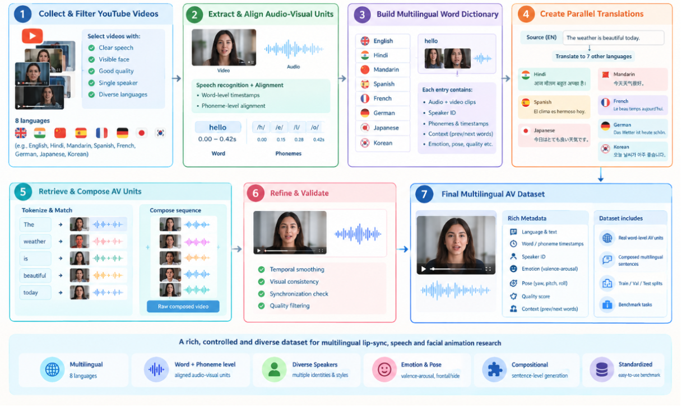
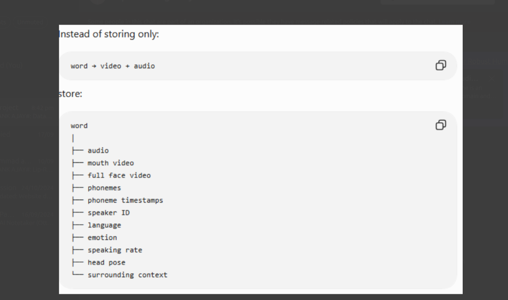

# Original user-supplied proposal

Provided on 2026-09-26. The following abstract and titles are preserved as supplied. They describe intended work, not completed results. The later Urdu-only, one-hour pilot decision supersedes the immediate eight-language scope. The eight-language idea remains archived context rather than an active requirement.

## Abstract

Multilingual audio-visual speech generation requires models to establish precise correspondence between linguistic content, speech acoustics, and facial movements across languages. However, existing audio-visual speech datasets are predominantly monolingual, sentence-level, or designed for recognition rather than compositional generation, while multilingual datasets often lack consistent word-level audio-visual correspondence. This limits the ability to systematically study cross-lingual lip synchronization, particularly when the same semantic content is expressed through languages with substantially different phonetic and temporal structures.

We propose a large-scale multilingual compositional audio-visual speech dataset constructed from naturally occurring online videos. The dataset is designed around a multilingual audiovisual word dictionary spanning eight languages, where individual lexical units are paired with their corresponding speech audio and facial video segments. For each source sentence, a translation system is used to obtain semantically equivalent target-language sentences, enabling the construction of multilingual audiovisual sequences by retrieving and composing corresponding units from the dictionary. Each unit is accompanied by linguistic and audiovisual metadata, including language, word and phoneme information, temporal boundaries, speaker identity, facial characteristics, and relevant contextual information.

The resulting dataset provides a controlled framework for studying how audiovisual speech units can be transferred and composed across languages while maintaining temporal correspondence between speech and facial articulation. Unlike conventional multilingual speech datasets that simply contain independent recordings in different languages, our dataset explicitly represents the relationship between linguistic units and their corresponding visual speech dynamics. This enables systematic evaluation of multilingual lip synchronization, cross-lingual audiovisual alignment, temporal consistency, and the effects of phonetic and linguistic differences on facial motion generation.

Beyond its word-level representation, the dataset is intended to support research at multiple temporal granularities, from phoneme and viseme sequences to complete sentences. We envision the dataset as a foundation for developing and evaluating multilingual talking-face and lip-sync generation systems, while providing a standardized testbed for investigating compositional audiovisual generation across languages, speakers, and speaking conditions.

## Supplied titles

Dataset: A Multilingual Compositional Audiovisual Speech Dataset for Cross-Lingual Lip-Sync Generation

Method: Cross-Lingual Compositional Lip-Sync Generation with Context-Aware Temporal Modellin

The final word in the method title is retained exactly as supplied.

## Supplied images

The diagrams are reference material, not execution instructions. In particular, their multilingual collection scope is not the current pilot scope, and their smoothing step does not establish that speaker identity or natural transitions are preserved.
